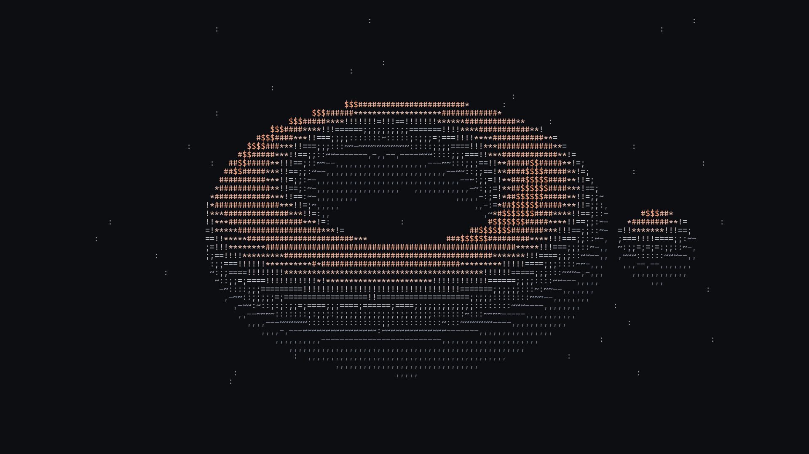

# ASCII-ART-Skill

An agent skill for ASCII art and ASCII motion graphics, in three modes:

1. **A model writes the animation.** Any LLM behind an OpenAI-compatible chat API, local or hosted, writes a small Python
   function, `frame(t)`, that draws one frame of an ASCII animation. The skill checks the code, runs it with limits, has
   the model fix what you saw, and renders the frames to a 1080p MP4 or PNG stills. It also records tokens, time and
   tok/s.
2. **A photo becomes ASCII art.** Any image becomes text, a PNG or a short video (reveal, zoom, pan, scan or glitch), in
   mono or in the photo's colours. No model is needed for this mode.
3. **A video becomes an ASCII video.** Each frame of a clip is converted, in mono, in colour or as half-block pixel art,
   and rendered to MP4 with the original sound. The output goes up to 4K.



## Contents

```
skills/ascii-motion-graphics/
  SKILL.md          the procedure: the code contract, steps, photo options, what to avoid
  scripts/ask.py    sends a prompt to any OpenAI-compatible endpoint, saves answers and code, logs usage and time
  scripts/check.py  static check of the model's code: only `math`, no I/O, no dunders
  scripts/frames.py runs frame(t) in a child process with restricted builtins and a time limit per frame
  scripts/render.py frames to PNG stills or an H.264 MP4 (1920x1080, 30 fps), mono shading or per-character colour
  scripts/photo.py  a photo or image to ASCII frames: character sets, colour, outlines, motion
  scripts/video.py  a video to ASCII or half-block frames, colour, one brightness range for the whole clip
  scripts/halfblock.py  shared code for half-block cells
  scripts/stats.py  tokens, time and tok/s of the answers used
```

You need Python 3.9 or newer and Pillow. The MP4 needs ffmpeg on PATH, and video input needs ffmpeg and ffprobe. `ask.py`, `check.py`, `frames.py` and
`stats.py` use only the standard library.

## Install

The skill is a folder with a `SKILL.md`. Each agent finds it in its own skills directory, so clone this repository and
link or copy `skills/ascii-motion-graphics` there.

| Agent | Skills directory |
|---|---|
| Claude Code | `~/.claude/skills/` |
| Codex CLI | `~/.agents/skills/` |
| Cline | `~/.cline/skills/` (or `.cline/skills/` in a project) |
| Hermes Agent | `~/.hermes/skills/` on Linux and macOS, `%LOCALAPPDATA%\hermes\skills\` on Windows |
| DeepSeek Harness (dsh) | `~/.dsh/skills/` |
| oh-my-pi (omp) | `~/.omp/agent/skills/` |
| pi | `~/.pi/agent/skills/` |

`install.ps1` (Windows) and `install.sh` (Linux, macOS) link the skill into every directory above whose agent is
installed:

```powershell
.\install.ps1            # directory junctions; -Copy copies instead
```

```bash
./install.sh             # symbolic links; --copy copies instead
```

An agent without skill support can still use it: paste `SKILL.md` into its prompt and let it run the scripts.

## Usage

Ask the agent, for example: "Turn this photo into a colour ASCII video with a reveal." Or: "Have the local model write a
3D ASCII animation and make a 20-second clip of it, with the run stats."

To convert a photo directly:

```bash
python -I scripts/photo.py photo.jpg work/me --cols 140 --color --motion reveal
python -I scripts/render.py work/me.json work/me.mp4 --loops 1
```

To convert a video, keeping its sound:

```bash
python -I scripts/video.py clip.mp4 work/v --color --fps 24
python -I scripts/render.py work/v.json work/v.mp4 --loops 1 --fps 24 --audio clip.mp4
```

## Safety

Model-written code is data until it passes `check.py` and you have read it. `frames.py` then runs it in a separate
process that can import only `math`, gets a short list of builtins, and is stopped if a frame takes longer than 10 s.
These are filters, not a sandbox, so do not run code that fails them. Images given to `photo.py` are only read as
pixels, and videos are only decoded to pixels by ffmpeg.

## License

MIT, see [LICENSE](LICENSE).
